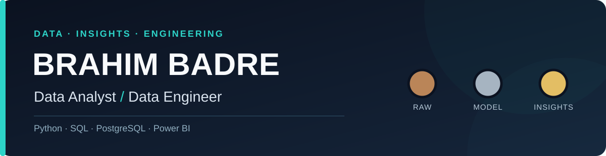

  

  <strong>From messy source data to structured datasets and useful analysis.</strong>

  
  
  

  Based in Morocco · Open to junior Data Analyst / Data Engineer opportunities and internships, locally and internationally

## What I work on

I'm Brahim, a data analyst focused on **data engineering and business intelligence**. Through hands-on training projects, I build workflows that make raw data easier to trust, query, and understand.

- **Prepare data people can use:** extract, clean, validate, and load data into structured PostgreSQL tables.
- **Turn data into answers:** use SQL, dimensional modeling, Power BI, and DAX to explore business questions.
- **Test ideas with evidence:** compare machine learning approaches, evaluate predictions, and inspect feature importance.

## Selected work

**01 · [Avito Real Estate Data Pipeline](https://github.com/badre2152/real-estate-pipeline)**

Property listings arrive as inconsistent source data. This project implements a Python/Selenium extraction and ETL workflow, with validation, PostgreSQL staging, and warehouse schemas designed for downstream analytics and ML.

**02 · [Real Estate BI Dashboards](https://github.com/badre2152/Real-estate-dashboard-and-repport)**

A reporting layer for questions about prices, locations, and listing trends. It uses Power Query, DAX, and Power BI on top of the related PostgreSQL data model.

**03 · [Real Estate Machine Learning Pipeline](https://github.com/badre2152/Real-Estate-Machine-Learning-Pipeline)**

A regression workflow for property prices, covering feature engineering, training-only preprocessing, baseline comparisons, model evaluation, and SHAP explainability.

**Beyond real estate:** [FootVision](https://github.com/badre2152/FootVision) explores football analytics and multi-source data processing.

*These are training and portfolio projects, not claimed production deployments. Current predictive performance is not stated without a reproducible, verified run.*

## Tools I use

**Analytics & BI:** SQL · Power BI · DAX · Power Query · Excel · pandas

**Data engineering:** Python · PostgreSQL · ETL · Data validation · Docker · Web scraping

**Machine learning:** scikit-learn · XGBoost · SHAP

**Also used in bootcamp projects:** Apache Airflow · Snowflake · Metabase

**Training:** Data Analyst, CCFBS × Simplon (January–August 2026).

---

## GitHub Activity

  <picture>
    <source media="(prefers-color-scheme: dark)" srcset="https://raw.githubusercontent.com/badre2152/badre2152/output/github-contribution-grid-snake-dark.svg">
    <source media="(prefers-color-scheme: light)" srcset="https://raw.githubusercontent.com/badre2152/badre2152/output/github-contribution-grid-snake.svg">
    
  </picture>

